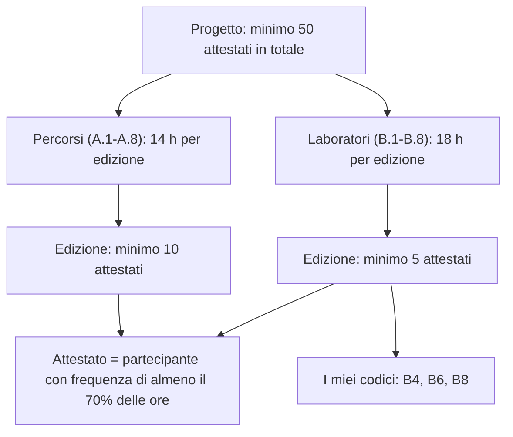

# Percorsi, laboratori e attestati, poi i casi di mancato pagamento per documento

Le citazioni sono testuali, con la pagina stampata nel PDF. Con **[lettura]** indico una mia deduzione che il documento non scrive.

## Come si distinguono percorsi, laboratori e attestati

Sono tre concetti di tipo diverso. Percorso e laboratorio sono due tipi di corso, l'attestato è il documento che prende il singolo partecipante.

- **Percorso di formazione e approfondimento.**  
  È un tipo di corso, fatto di lezioni o workshop, in presenza, online o misto. Pagina 5 dell'avviso ministeriale: "Ciascuna lezione è tenuta da un formatore esperto [...] coadiuvato da un tutor." Serve almeno 1 gruppo di 10: "I Percorsi sono erogati a gruppi di almeno 10 corsisti che conseguono l'attestato finale."  
  Nell'avviso della scuola i percorsi sono i codici A.1-A.8, da 14 ore per edizione (pagina 2, tabella).
- **Laboratorio formativo sul campo.**  
  È un tipo di corso diverso: un ciclo di incontri **in presenza** di tutoraggio, mentoring, affiancamento. Pagina 5: "I Laboratori formativi sul campo [...] sono erogati a gruppi di **almeno 5 unità di personale** che conseguono l'attestato finale." Non è previsto il tutor.  
  Nell'avviso della scuola i laboratori sono i codici B.1-B.8, da 18 ore per edizione (pagina 4, tabella). **I miei tre codici, B4, B6 e B8, sono laboratori** (pagine 4 e 5 dell'avviso della scuola).
- **Edizione.** È una singola realizzazione di un percorso o di un laboratorio, con un suo gruppo di partecipanti.
- **Attestato.**  
  È il certificato finale del singolo partecipante. Per ottenerlo serve la frequenza: pagina 6 dell'avviso ministeriale, "una partecipazione ad **almeno il 70% delle ore** previste dal percorso/laboratorio".  
  Per un mio laboratorio da 18 ore, il 70% è 12,6 ore, quindi servono 13 ore di presenza (calcolo mio).
- **Iscritto non è attestato.**  
  Un iscritto che frequenta meno del 70% non genera un attestato. Le soglie di 5, 10 e 50 contano gli attestati, non gli iscritti.
- **Soglie, in ordine di grandezza.**  
  **5 attestati per ogni edizione di laboratorio**, 10 per ogni edizione di percorso, 50 per l'intero progetto (pagina 4, art. 4, comma 7: "Ciascun progetto finanziato dovrà garantire la partecipazione complessiva di un minimo di 50 unità di personale scolastico che conseguono l'attestato finale.").

## 1. Avviso interno della scuola (prot. 10890/2026)

- **Laboratori: minimo di 5 attestati.**  
  Pagina 4: "I Laboratori formativi sul campo, anche con il coinvolgimento degli studenti, sono erogati a gruppi di **almeno 5** unità di personale che conseguono **l'attestato finale**."
- **Monitoraggio del numero minimo, senza cifre.**  
  Pagina 6, tutor: "segnala in tempo reale al Dirigente Scolastico se il numero dei partecipanti scende al di sotto del previsto in relazione al numero minimo di attestazioni da raggiungere".  
  [lettura] La scuola controlla il rischio, ma l'avviso non scrive le conseguenze sul compenso.
- **Pagamento solo per le ore effettivamente prestate.**  
  Pagina 10, art. 5, comma 1: "ESPERTO € 122,00 (Euro centoventidue/00), inteso quale importo lordo stato, rapportato alle ore effettivamente prestate."
- **Il compenso rinvia alla lettera di incarico.**  
  Pagina 10, art. 5, comma 2: "Il corrispettivo verrà erogato come specificato nella lettera di incarico."
- **Scadenza dell'incarico.**  
  Pagina 10, art. 4, comma 1: "L'attività oggetto dell'incarico decorrerà dalla sottoscrizione della lettera d'incarico e fino al 31/12/2026."  
  [lettura] Le ore non svolte entro questa data non sono pagate.
- **Il differimento è eccezionale.**  
  Pagina 10, art. 4, comma 2: "L'eventuale differimento del termine di conclusione dell'incarico originario è consentito, in via eccezionale, al solo fine di completare il progetto **e per ritardi non imputabili al collaboratore**, ferma restando la misura del compenso pattuito".
- **Importo massimo per edizione di laboratorio.**  
  Pagina 4: "18" ore per edizione, 8 edizioni, 8 esperti, "2.196,00 €" per esperto.  
  Il calcolo 18 × 122 = 2.196 è mio.
- **Impegni a mio carico.**  
  Pagina 6: "Comunicare preventivamente eventuali impedimenti all'attività di docenza per eventuale tempestiva rimodulazione del calendario" e "Caricare la documentazione in piattaforma di gestione ove richiesto".  
  [lettura] Documentazione mancante o tardiva può bloccare il riconoscimento delle ore.

## 2. DM 219/2025

Il decreto non contiene soglie di attestati, importi per l'esperto né clausole di decurtazione. Non dice quando e come mi pagano.

- **Rinvio ad avvisi e accordi.**  
  Pagina 8, art. 1, comma 2: l'Unità di missione provvede "alla stipula degli accordi di concessione del finanziamento con i soggetti attuatori, alla definizione di indicazioni per la progettazione, la gestione, la rendicontazione e il monitoraggio degli interventi, in coerenza con i target le condizionalità delle linee di investimento del PNRR".  
  [lettura] Le regole che mi riguardano sono nell'avviso ministeriale, nella sezione 4.
- **Controlli formali.**  
  Pagina 8, art. 1, comma 3: i controlli "sono svolti dai revisori dei conti delle istituzioni scolastiche tramite apposita piattaforma digitale".  
  [lettura] Una spesa non conforme può essere contestata alla scuola. Il DM non dice come ricade su di me.

## 3. Lettera di incarico (prot. 12269/2026)

- **Collegamento a target e milestone.**  
  Pagina 2: le attività sono "funzionalmente vincolate all'effettivo raggiungimento di target e milestone e degli obiettivi finanziari stabiliti nel PNRR".
- **Ore solo fuori orario di servizio.**  
  Pagina 3, lettera a: "Le ore considerate sono da intendersi rigorosamente in orario aggiuntivo a quello di servizio."
- **Nessun compenso per ore in concomitanza con il servizio.**  
  Pagina 3, lettera b: "Nessun importo verrà riconosciuto a fronte di orario prestato in concomitanza di servizio ordinario neanche sotto forma di recupero o di intensificazione".
- **Solo ore effettivamente prestate, con tetto di 18 ore per codice.**  
  Pagina 3, lettera c: "Verranno riconosciute esclusivamente le ore di servizio effettivamente prestato." Il tetto è di 18 ore ciascuno per B4, B6 e B8.
- **Orario rimodulabile.**  
  Pagina 3, lettera d: "L'orario indicato potrà subire rimodulazioni in funzione della effettiva erogazione da parte del MIM".
- **Pagamento condizionato ai fondi del Ministero.**  
  Pagina 3, lettera e: "Il pagamento verrà effettuato solo a seguito di erogazione dei fondi da parte del MIM."  
  [lettura] È il rischio principale. Non c'è una data né un termine massimo (vedi sezione 4 per le tranche).
- **Anticipo possibile, non dovuto.**  
  Pagina 3, lettera f: "È consentito, esclusivamente in presenza di disponibilità di fondi, anticipare il compenso in quota parte corrispondente alle ore effettivamente prestate".
- **Obblighi di comunicazione.**  
  Pagina 5, lettere e ed f: mi impegno a "comunicare tempestivamente all'Istituzione scolastica eventuali variazioni" e "qualsiasi altra circostanza sopravvenuta di carattere ostativo rispetto all'espletamento dell'incarico". Pagina 4: se emerge la non veridicità delle dichiarazioni "si avrà la decadenza dai benefici eventualmente ottenuti".

## 4. Avviso ministeriale prot. 73226 del 27/03/2026

- **Sotto soglia, l'edizione non è valida né riconoscibile ai fini della spesa.**  
  Pagina 6, art. 5, comma 3: "Il numero minimo di partecipanti alle attività di formazione è riferito al numero minimo di attestati che dovrà essere rilasciato al termine del percorso da ciascuna istituzione scolastica attuatrice, che concorre altresì al target da raggiungere e, pertanto, rappresenta il valore necessario per la validità e riconoscibilità del percorso/laboratorio e delle spese."  
  [lettura] Se un mio laboratorio chiude con meno di 5 attestati, il Ministero non riconosce quell'edizione né le sue spese. La scuola non recupera i 122 euro all'ora. L'avviso non dice se il compenso dell'esperto cada con essa. Lo decide la scuola.
- **Il finanziamento è a costi standard.**  
  Pagina 5: "Le Unità di costo standard (UCS) sono pari a € 122,00 per la figura del formatore."  
  Pagina 9, art. 11, comma 1: "La rendicontazione delle spese sostenute con il presente Avviso avviene sulla base delle opzioni semplificate di costo".  
  [lettura] La scuola incassa a unità standard solo per ciò che risulta valido.
- **Le edizioni fuori piattaforma non sono ammissibili.**  
  Pagina 4, art. 4, comma 6: "I percorsi formativi non inseriti nella piattaforma non saranno ammissibili ai fini del finanziamento."  
  [lettura] Una mia lezione non registrata su "Scuola futura" non genera finanziamento.
- **Il cronoprogramma è vincolante.**  
  Pagina 4, art. 4, comma 8: "Le attività dovranno rispettare il cronoprogramma definito sul sistema informativo 'Futura PNRR – Gestione progetti'."
- **Il Ministero eroga a tranche, dopo controlli.**  
  Pagina 9, art. 11, comma 2, lettera a: "anticipazione pari al 50% dell'importo richiesto".  
  Pagina 10, lettera b: "una quota intermedia di pagamento fino al raggiungimento di un massimo del 90% dell'importo effettivamente assegnato, sulla base della presentazione di eventuale apposita rendicontazione intermedia".  
  Pagina 10, lettera c: "il restante 10% a saldo, previa rendicontazione delle spese sostenute a conclusione del progetto, sottoscritta dal dirigente scolastico e oggetto di controllo da parte dei revisori dei conti".  
  [lettura] Il pagamento a me, vincolato dalla lettera di incarico (sezione 3, clausola e) all'erogazione del Ministero, può arrivare molto dopo le lezioni.
- **Il Ministero può revocare l'avviso senza indennizzo.**  
  Pagina 11, art. 16, comma 3: "L'Amministrazione si riserva di revocare o annullare la presente procedura senza che i partecipanti possano vantare alcuna pretesa."  
  [lettura] Riguarda l'avviso e le candidature. Il progetto della scuola ha già un accordo di concessione (citato a pagina 2 della lettera di incarico), quindi non è il rischio principale.

## Cosa non è scritto in nessun documento

1. Cosa succede al compenso se un laboratorio chiude con meno di 5 attestati.
2. Entro quanto tempo la scuola mi paga dopo l'erogazione del Ministero.
3. Se una lezione saltata per cause non mie viene recuperata e pagata.

Sono domande da fare alla scuola per iscritto.

