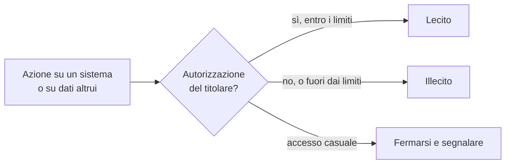

## 1.2.6 Attività: legale o no?

Criterio comune a tutte le situazioni: ciò che rende lecita un'azione su un sistema è l'**autorizzazione** di chi ne ha il diritto, non la facilità tecnica, l'assenza di danni o la buona intenzione.

**1. Password del compagno indovinata, messaggi letti senza modificare nulla**  
Illecito.  
Accesso abusivo a un sistema informatico (art. 615-ter c.p.): l'account è protetto da password, cioè da una misura di sicurezza, e il titolare non ha autorizzato l'accesso. Leggere i messaggi può configurare anche la violazione di corrispondenza (art. 616 c.p., che comprende la corrispondenza informatica). Non aver modificato nulla non esclude il reato.  
Invece: nessun tentativo; se si conosce per caso la password altrui, avvisare il compagno perché la cambi.

**2. Dati di un altro utente visibili per caso sul sito della scuola**  
Accorgersene è lecito; continuare a esplorare non lo è.  
Cosa fare: chiudere la pagina, annotare data, ora e indirizzo della pagina, segnalare subito al docente o alla segreteria.  
Cosa non fare: ricaricare la pagina o cambiare parametri per vedere altri utenti, salvare o fotografare i dati, mostrarli ai compagni, pubblicare la scoperta.  
Restare nel sistema o tornarci dopo essersi accorti dell'errore può configurare l'accesso abusivo ("mantenersi" nel sistema contro la volontà del titolare, art. 615-ter c.p.).  
Nota per il docente: per la scuola, titolare del trattamento, si tratta di una possibile violazione di dati personali; va coinvolto il responsabile della protezione dei dati (DPO), che valuta la notifica al Garante entro 72 ore (art. 33 GDPR).

**3. Tecnico incaricato per iscritto che verifica i server nel periodo concordato**  
Lecito, entro i limiti dell'incarico.  
Diventa illecito se esce dal perimetro concordato (altri sistemi, altre tecniche, altre date). Dipende anche da chi possiede i server: se sono ospitati da un fornitore esterno (cloud, hosting), serve anche il consenso del fornitore o il rispetto delle sue regole sui test di sicurezza.

**4. Wi-Fi del vicino, password trovata su un biglietto**  
Illecito.  
La rete è protetta da password, quindi è un sistema con misure di sicurezza; conoscere la password non equivale ad avere il permesso di usarla (art. 615-ter c.p.).  
Invece: restituire il biglietto o avvisare il vicino; per usare la rete, chiedere il permesso.

**5. Download di un elenco di password rubate "solo per vedere se c'è anche la sua"**  
Da non fare; a seconda dello scopo e dell'uso può costituire reato.  
Procurarsi e conservare codici di accesso altrui è punito dall'art. 615-quater c.p. quando c'è lo scopo di trarne profitto o di arrecare danno; anche senza quello scopo, si detengono dati personali di migliaia di persone ottenuti illecitamente. I forum che distribuiscono questi elenchi sono inoltre una fonte frequente di malware.  
Invece: usare servizi che effettuano il controllo senza distribuire i dati, per esempio Have I Been Pwned (https://haveibeenpwned.com/); se l'indirizzo risulta compromesso, cambiare la password e attivare l'autenticazione a due fattori.

**6. Premio per chi segnala vulnerabilità seguendo le regole pubblicate (bug bounty)**  
Lecito, finché si rispettano le regole del programma.  
Le regole pubblicate valgono come autorizzazione: definiscono quali sistemi si possono testare, quali tecniche sono escluse e come segnalare. Fuori da quelle regole l'attività torna illecita. Molti programmi fissano un'età minima o richiedono il consenso dei genitori: per gli studenti minorenni va verificato.

## Esercizi

**1. Differenza tra ethical hacker e criminale informatico**  
Le tecniche possono essere le stesse; cambiano:

- **autorizzazione**  
  l'ethical hacker opera con un permesso esplicito (contratto, incarico scritto, regole di un bug bounty); il criminale senza;  
- **limiti**  
  l'ethical hacker resta nel perimetro e nei tempi concordati;  
- **scopo**  
  migliorare la sicurezza del titolare, non trarre profitto o danneggiare;  
- **uso dei risultati**  
  le vulnerabilità sono comunicate in modo riservato al titolare, non sfruttate né vendute.

Risposta accettabile se contiene almeno autorizzazione e scopo.

**2. Passi corretti se ci si accorge di un possibile errore di sicurezza**

1. Fermarsi: non verificare, non ripetere, non sfruttare l'errore.
2. Annotare cosa è successo: servizio, data e ora, operazione che si stava facendo; non salvare dati di altre persone.
3. Segnalare al titolare tramite il canale previsto: pagina o modulo per la segnalazione di vulnerabilità, indirizzo indicato nel file `security.txt` del sito (standard RFC 9116), assistenza clienti. Uno studente minorenne segnala al docente o a un genitore, che si occupano del contatto.
4. Non divulgare la scoperta finché il titolare non ha corretto il problema.
5. Non chiedere compensi come condizione per fornire i dettagli: una richiesta del genere può essere interpretata come tentativo di estorsione.

**3. Soggetti del territorio probabilmente soggetti a NIS2**  
In Italia la direttiva NIS2 è recepita dal D.Lgs. 138/2024 (sintesi: Panoramica della legge italiana NIS2, https://advisera.com/it/articoli/italiano-nis2-decreto-legislativo/). Due criteri:

- **settore**  
  energia, trasporti, settore bancario, sanità, acqua potabile e acque reflue, infrastrutture digitali, pubblica amministrazione, servizi postali, gestione dei rifiuti, chimica, alimentare, manifattura di alcuni prodotti, fornitori di servizi digitali, ricerca;  
- **dimensione**  
  in generale medie e grandi imprese (almeno 50 dipendenti o fatturato superiore a 10 milioni di euro); alcuni soggetti rientrano a prescindere dalla dimensione.

Tra le amministrazioni pubbliche il decreto include, a determinate condizioni, città metropolitane, comuni con più di 100.000 abitanti e aziende sanitarie locali; tra i trasporti, il trasporto pubblico locale.  
Risposte attese: ospedali e ASL, aziende di trasporto pubblico di dimensioni medio-grandi, distributori di energia e gas, gestori del servizio idrico, il comune se supera i 100.000 abitanti. Una piccola azienda locale fuori dai settori elencati, di norma, non rientra. La risposta è corretta se motivata con settore e dimensione: il "probabilmente" della consegna riflette il fatto che l'applicabilità effettiva si verifica caso per caso.

## 1.2.7 Aspetti orientativi: traccia per la discussione

Perché la reputazione di affidabilità è così importante:

- chi lavora nella sicurezza riceve accesso a sistemi e informazioni riservate del cliente: viene scelto se ci si può fidare;
- le stesse competenze permettono di proteggere o di attaccare: la differenza la fanno l'etica e il rispetto degli accordi, che il cliente non può verificare in anticipo;
- molti incarichi richiedono accordi di riservatezza, controlli sui precedenti e talvolta abilitazioni di sicurezza: un comportamento scorretto, anche commesso da giovane, può precludere queste opportunità;
- il settore è piccolo e basato sulle referenze: una violazione della fiducia si viene a sapere e chiude porte difficili da riaprire.

Collegamento con il resto della lezione: le regole del laboratorio sottoscritte in 1.2.5 sono una prima esperienza di lavoro entro un perimetro autorizzato, come in un incarico professionale.
